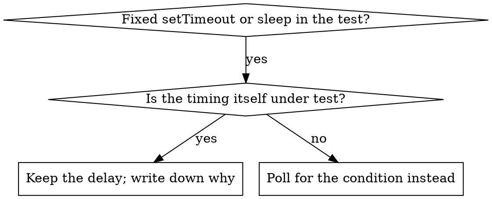

# Condition-Based Waiting in Tests

**Use it when** a test waits for async work with a fixed delay such as `setTimeout`, `sleep` or `time.sleep()`. Typical signs: a suite that times out only with parallel workers, failures under load that vanish on rerun, and async completion awaited through a sleep.

**Skip it when** timing is the thing under test, such as a debounce window or a throttle interval. The fixed delay stays, and a comment records WHY.

A fixed delay encodes an assumption about machine speed. A CI runner under load breaks that assumption, and the test flips between pass and fail.



## Method

1. Name the condition the test is really waiting for: an event, a state, a count, a file.
2. Replace the sleep with a poll on that condition:

   ```typescript
   // ❌ Guesses that the upload worker finishes inside 400 ms
   await new Promise((r) => setTimeout(r, 400));
   expect(uploads.get(jobId)?.status).toBe('stored');

   // ✅ Waits until the worker reports the job as stored
   await waitFor(() => uploads.get(jobId)?.status === 'stored', 'upload stored');
   expect(uploads.get(jobId)?.status).toBe('stored');
   ```

3. Pick the poll shape that fits the condition:

   | Waiting for | Poll |
   |-------------|------|
   | An event arrives | `waitFor(() => bus.history().find((m) => m.type === 'DONE'), 'DONE message')` |
   | A state is reached | `waitFor(() => player.state === 'ready', 'player ready')` |
   | A count is reached | `waitFor(() => inbox.items.length >= 5, 'five items')` |
   | A file appears | `waitFor(() => fs.existsSync(reportPath), 'report written')` |
   | Several conditions hold | `waitFor(() => cart.locked && cart.total > 10, 'locked cart over 10')` |

4. Use a generic poller when the project has none:

   ```typescript
   async function waitFor<T>(condition: () => T | undefined | null | false, description: string, timeoutMs = 5000): Promise<T> {
     const began = Date.now();
     for (;;) {
       const value = condition();
       if (value) return value;
       const waited = Date.now() - began;
       if (waited > timeoutMs) throw new Error(`Timeout waiting for ${description} after ${timeoutMs}ms`);
       await new Promise((r) => setTimeout(r, 10)); // next probe in 10 ms
     }
   }
   ```

   `condition-based-waiting-example.ts` in this directory holds event-specific versions: `waitForEvent`, `waitForEventCount` and `waitForEventMatch`.

5. Keep a fixed delay only when the test checks timing, and only after the trigger:

   ```typescript
   // The heartbeat timer fires every 100 ms; the assertion needs two beats.
   await waitForEvent(threadManager, threadId, 'HEARTBEAT_STARTED');
   await new Promise((r) => setTimeout(r, 200)); // 200 ms = 2 beats of the 100 ms timer
   expect(beats(threadId)).toBeGreaterThanOrEqual(2);
   ```

   Any fixed delay you keep needs the three things this one has. A comment says why it exists. Its length comes from a known interval. And it starts only after the test has awaited the condition that begins the timed behaviour.

## Rules

- The assertion needs a state, so the test waits for that state. A sleep only bets on when the state arrives.
- Poll at 10 ms intervals.

  ```typescript
  // ❌ setTimeout(check, 1) spins the CPU for no gain
  // ✅ setTimeout(check, 10)
  ```

- A poll with no upper bound can hang the suite. End each poll with an error that names what never happened.

  ```typescript
  // ❌ while (!queue.drained) await tick();
  // ✅ await waitFor(() => queue.drained, 'queue drained', 3000);
  ```

- Call the getter inside the loop. A value captured before the loop never changes.

  ```typescript
  // ❌ const snapshot = store.read(); await waitFor(() => snapshot.ready, 'ready');
  // ✅ await waitFor(() => store.read().ready, 'ready');
  ```

## Recorded result

Evidence, 2025-10-03 session: no race conditions remain; the suite runs 40% faster; the pass rate rose from 60% to 100% once the team fixed 15 flaky tests in 3 files.
