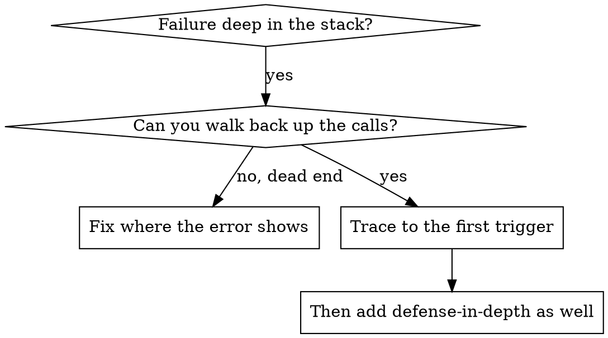
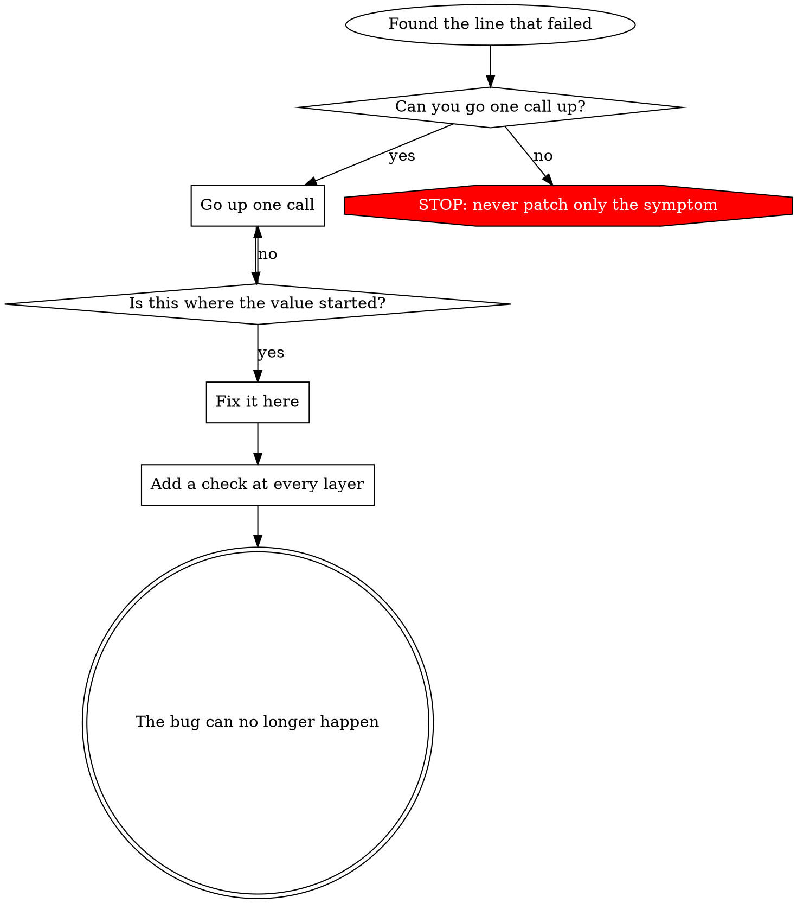

# Tracing a Bug to Its Root Cause

**Symptom:** the failure surfaces deep in a call stack, far from where the bad input entered.
**Technique:** move up one caller at a time to the frame that produced the value, and fix that frame.

Typical cases: a database file opened at an unexpected path, a file written to the wrong folder, a git repository initialised inside the source tree. The throwing frame only shows where the damage became visible. A patch there removes one symptom; the cause keeps producing others.

Reach for it when:

- you must find the test or code path that sets the problem off;
- nobody knows where the bad data came from;
- the trace runs through a long chain of frames.



## Method

1. **Write down the symptom exactly as it appears.**

   ```
   Error: git init exited 128 in /home/dev/monorepo/packages/engine
   ```

2. **Find the line that produced it.** Here, the bootstrap step shells out to git:

   ```typescript
   await execFileAsync('git', ['init'], { cwd });
   ```

3. **Ask who called that line, and who called the caller.** Write the chain down:

   ```
   RepoBootstrapper.initialise()
     ← Workspace.prepare()
     ← Engine.createWorkspace()
     ← test: "creates a workspace for a new tenant"
   ```

4. **Check the value each frame passed down.** Here, `cwd` arrived as `''`. Node treats an empty `cwd` as `process.cwd()`, so git ran inside the source tree.

5. **Keep going until you reach the code that created the value.**

   ```typescript
   // test/helpers/sandbox.ts
   export function useSandbox() {
     const box = { root: '' }; // filled in later by beforeEach
     beforeEach(async () => {
       box.root = await mkdtemp(join(tmpdir(), 'engine-'));
     });
     return box;
   }

   // engine.test.ts
   const box = useSandbox();
   const engine = new Engine({ root: box.root }); // runs at import time: root is still ''
   ```

   The test file reads `box.root` at module load, before any `beforeEach` has run.

### When reading the code is not enough

Log the context just before the risky call, then run the tests:

```typescript
async function initialise(cwd: string) {
  const callers = new Error().stack;
  console.error('TRACE git init', {
    cwd,
    processCwd: process.cwd(),
    environment: process.env.NODE_ENV,
    callers,
  });
  await execFileAsync('git', ['init'], { cwd });
}
```

Capture only those lines:

```bash
npm test 2>&1 | grep -F 'TRACE git init'
```

In the captured traces, look for:

- the test file names that appear in each trace;
- the line number that starts the bad call;
- a repeat: the same test each time, or the same parameter value.

### When an unknown test leaves something behind

A stray artefact shows up after a full suite run, and no single test is the obvious source. `find-polluter.sh`, in this directory, bisects the suite file by file: after each test file it checks for the artefact, and it names the first file after which the artefact exists. Its header comment gives the arguments.

```bash
bash ./find-polluter.sh 'packages/engine/.git' 'src/**/*.test.ts'
```

## Worked case: empty project directory

Symptom: a `.git` directory appeared inside `packages/engine/`, a source package.

The trace, from the failure back to its origin:

1. git ran with `process.cwd()` as its directory.
2. The `cwd` argument it received was an empty string.
3. `Engine.createWorkspace()` passed that empty string through.
4. The test built the engine at module load, reading the sandbox root.
5. The sandbox helper returns `{ root: '' }` until `beforeEach` fills it.

Root cause: a top-level variable read a value that set-up had not assigned yet.

Fix: `useSandbox()` now exposes `root` through a getter, and reading it before `beforeEach` throws.

Defense-in-depth then added guards along the route:

- `RepoBootstrapper` writes a stack trace to the log before each `git init`.
- Under `NODE_ENV=test`, `RepoBootstrapper` refuses to run `git init` anywhere outside the OS temp directory.
- `Workspace.prepare()` throws on an empty directory.
- `Engine.createWorkspace()` validates its directory argument on entry.



## Rules

- The fix belongs in the frame that created the bad value.
- The throwing line is evidence. On its own it is never the fix site.
- Test runs often silence the app logger, but `console.error()` output survives, so instrument tests with it.
- Emit the log line before the risky call; code after a crash may never execute.
- Each log entry carries timestamps, environment variables, `process.cwd()` and the target directory.
- `new Error().stack` returns the full chain of callers without throwing.

## Recorded result

Evidence, 2025-10-03 session: 1847 tests green with no pollution left, after 4 defense layers, a getter check at the source and a 5-frame trace.
