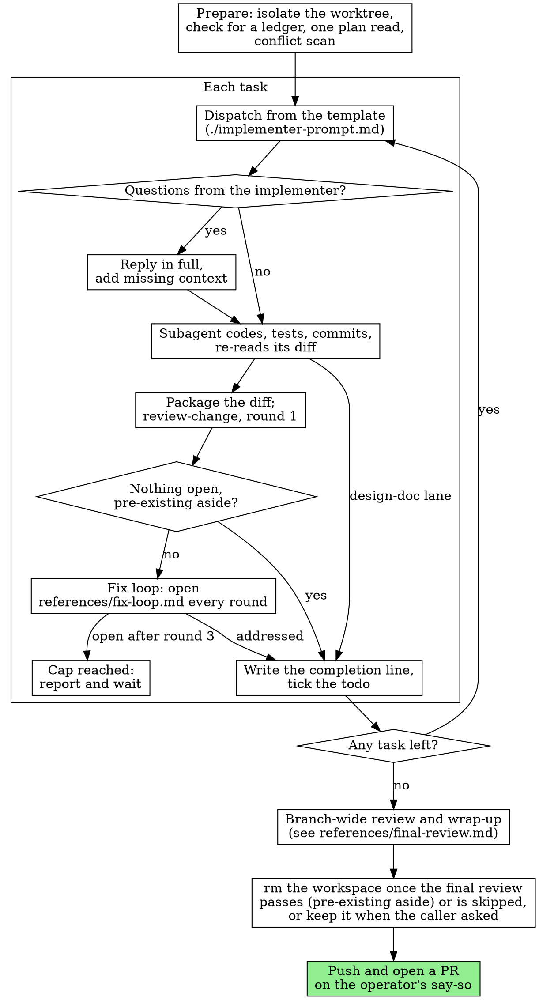

# run-plan

run-plan carries a written plan through this session: a new implementer subagent takes each task, and one `review-change` round checks it.
After the last task, one broad `review-change` covers the whole branch, and the design-doc lane skips both kinds of review.

**The routing section** means the `route-subagents` skill. **REQUIRED SUB-SKILL:** read it before the first dispatch.
**The design-doc lane** is the lane that section defines. Wherever it applies below, task review and final review drop out.
With no subagent tool, each role runs in the main session, in order, whichever routing source applies.

**Why subagents.** The controller's context is the scarce resource, and coordination across the plan needs all of it.
So each task goes to a subagent that starts blank and sees none of this session's history.
You, the controller, write the exact context it needs and nothing beyond.

## Stop only for

1. An irreversible or destructive operation.
2. A security-sensitive action.
3. A merge, a publish, a shared-branch push, or a similar act beyond this worktree. Convention puts each one to the operator first.
4. The fix-loop cap: after review round 3, the task still has open findings other than `pre-existing` ones.
5. A plan so broken that each possible next step is a guess.

| Condition | Action |
|---|---|
| 1, 2, 3 or 5 | Stop and ask the operator |
| 4, the cap | Report, then wait |
| Every task complete | The run ends normally |
| Anything else | Keep going |

Keep going means no check-in between tasks, no "Should I continue?", and no progress summary mid-plan.
Chat gets one short line between tool calls at most. Anyone reconstructing the run reads the ledger and the tool output instead.

## Rulings, not stalls

Nobody waits on a human while a plan runs. Conflicts, ambiguities and plan defects each get a ruling from you.

| Source | Weight |
|---|---|
| Spec | Binding |
| Plan | The spec's argument; it yields to the spec |
| Your judgment | Settles whatever the other two leave open |

Compare the two failure costs. A bad ruling produces rework that shows in the ledger and can be reverted.
Each question left waiting turns the operator's working day into idle time.

Record the ruling as one ledger line and carry on:

```
Ruling: <what you decided> — <why> — <what it costs if wrong>
```

A decision in one of five key classes (`contract`, `data_model`, `architecture`, `security_release`, `timeline`) carries its class in brackets:

```
Ruling: [<key_class>] <what you decided> — <why> — <what it costs if wrong>
```

Every ruling starts with `Ruling:`, tagged or not.

## When to use

| Situation | Do |
|---|---|
| No implementation plan exists yet | Execute by hand, or run `brainstorm` first |
| A plan exists, but its tasks are tightly coupled | Execute by hand, or run `brainstorm` first |
| A plan exists, and its tasks are mostly independent | Run `run-plan` |

## Process flow



## Setup

Invoke every script this page names by absolute path, from the working tree running the plan. They live in this skill's `scripts/` directory.

1. **Worktree.** The `CLAUDE.md` section "Worktree location" says where worktrees go when it exists; otherwise use `$WORKTREE_ROOT`, else `$HOME/worktrees`. Create one there, or confirm the one you are in.
2. **Branch.** `main` and `master` are off limits for implementation until the operator explicitly agrees.
3. **Workspace.** `bash scripts/sdd-workspace -C <worktree> PLAN_FILE` prints the plan's workspace directory.
4. **Existing ledger.** Look for `<workspace>/progress.md`. When it exists, [references/resuming.md](references/resuming.md) comes first. That file decides whether the ledger is yours and which task is next.
5. **New ledger.** When no ledger exists, start one whose first line is `# SDD ledger — plan: <plan file path>`. A caller may pass `Plan gate passed by caller: <path>` and `Keep workspace`. Header notes start at line 2. The first blank line ends the header; with no notes, line 2 is that blank line. Write each caller note there, and find each later by its prefix.
6. **Plan.** One read is enough. Open a todo for every task, and keep the plan's context and Global Constraints in view.
7. **Spec.** A Spec named by the plan outranks the plan, and plan-internal conflicts resolve in its favour. Read it.
8. **No spec.** Write a ledger note that none was reachable. Rulings made without a spec count as provisional.
9. **Plan gate.** When the ledger header holds `Plan gate passed by caller: <path>`, skip the gate. Record `Ruling: plan gate skipped — caller gate record <path> — <cost>` unless the ledger already holds it. When the header holds `Own plan gate: ran`, skip the gate; it already ran. Otherwise run the gate the routing section prescribes, then write `Own plan gate: ran` in the ledger header. Whoever revises a plan after its gate removes `Own plan gate: ran` before resume.
10. **Conflict scan.** Work through every step of [references/preflight.md](references/preflight.md). The ledger gets the scan's table and every ruling you make on it. Dispatch Task 1 only once steps 9 and 10 are done.

### Ledger and workspace

Each plan owns one git-ignored directory under `<repo-root>/.tl-relay/sdd/`.
Ledger, briefs, reports and review packages all live there.

Todos alone vanish at compaction, along with conversation memory.
Compaction is behind the worst failure on record: controllers that kept no ledger sent completed tasks out to implementers a second time.

| When | Do |
|---|---|
| Context was compacted | Rebuild state from the ledger and `git log`, not from memory. The commits the ledger names exist in git either way. |
| `git clean -fdx` ran | The workspace was git-ignored scratch, so it is gone. Rebuild from `git log`. |
| Another plan's directory sits beside yours | Leave it unread and unwritten. |

## Task loop

Your context keeps, for the rest of the session, every byte you paste into a dispatch prompt and every byte a subagent returns.
Every later turn re-reads them. Pass artifacts as files instead.

| Before dispatching | Do |
|---|---|
| Several tasks are the same small edit across files | Read [references/batching.md](references/batching.md) first |
| An implementer is already running | Wait for it; two at once collide on files |

### Step 1 — Dispatch

**You do**

- **Brief.** `bash scripts/task-brief -C <worktree> PLAN_FILE N` writes the task's full text to its own file and prints the path. Requirements come from that file alone.
- **Report path.** Swap `brief` for `report` in the brief's name: `…/task-N-brief.md` becomes `…/task-N-report.md`.
- **BASE.** Capture `git -C <worktree> rev-parse HEAD` just before dispatching. The review package, every fix-round diff and round 1's range base depend on it.
- **Agent id.** The dispatch result names the implementer. Save it: fix rounds resume that agent unless the fix loop escalates.

**You hand over**, in this order, through the [implementer template](implementer-prompt.md):

1. A single line on the task's place in the project.
2. The brief's path, labelled as the first thing to read: requirements, plus exact values to use as written.
3. Interfaces and decisions settled by earlier tasks, which the brief predates.
4. How you resolved any ambiguity you saw in the brief.
5. Where to write the report, and the report contract.

Carry a pointer to the ledger entry when an earlier task deferred a finding near this one.
The report file gets everything. The reply to you carries only the status, commits, one test line and concerns.

**Never**

- **Exact values in the prompt.** Numbers, magic strings, signatures and test cases appear in the brief and nowhere else.
- **The plan file.** The implementer reads its brief. Opening the full plan is not its job.
- **Pasted history**, such as "state after Tasks 1-3". The observed cost: a 42k-character dispatch, 99% of it old summaries. Limit the prompt to this task, the interfaces it touches and the global constraints.
- **Dropping the no-subagents clause.** The template keeps the implementer from spawning helpers or a reviewer. You review after the report, outside the design-doc lane. Each worker-spawned reviewer seen so far repeated your task review, one extra seat per task.

### Step 2 — Read the status

| Implementer returns | You do |
|---|---|
| DONE | In the design-doc lane, skip to step 5. Otherwise run `bash scripts/review-package -C <worktree> PLAN_FILE BASE HEAD` and give `review-change` the unique path it prints. |
| DONE_WITH_CONCERNS, NEEDS_CONTEXT or BLOCKED | Follow [references/handling-reports.md](references/handling-reports.md), on every occurrence |
| A question, before starting or mid-task | Let the implementer resume only once its question has a complete, plain answer and the context it was missing |

The `BASE` in that command is the commit captured before dispatch.
`HEAD~1` would not do: on a task with three commits, review would see only the last one.

### Step 3 — Task review

This review gates one task. Breadth across the branch waits for the final review.

| Rule | Exception |
|---|---|
| Every task gets its task review | The design-doc lane |
| An open `scope` finding means the task is not accepted | None |
| The implementer's self-review counts as no substitute | None |

**Diff.** `bash scripts/review-package -C <worktree> PLAN_FILE BASE HEAD` writes the diff to a file, and `review-change` gets that path.
The package's contents stay out of your context. You never call `review-change` without a diff file.

**Ranges.** Round 1 starts at `BASE`. Each later round starts at the head the round before it reviewed.
All rounds pass `BASE` too, as round 1's base, and `review-change` judges `pre-existing` against it.

| Input | Value |
|---|---|
| Worktree | The worktree path |
| Range base | `BASE` in round 1, the prior round's head later |
| Round 1's base | `BASE` |
| Head | The head SHA |
| Diff | The review-package file |
| Task | The same brief file, plus the report file |
| Success criteria | The task's success criteria |
| Global constraints | Those binding this task |
| Prior findings | Every finding already reported |

The reviewer reads the global-constraints block most closely.
You fill that block from the plan's Global Constraints or the spec. Each binding requirement keeps its exact wording.
Cover exact values and formats. Cover stated relationships between components too, such as "same layout as X" or "matches Y".

Two things become `scope` findings in `review-change`: a change nobody requested, and a requirement nothing implements.

| Don't write into the reviewer prompt | Because |
|---|---|
| "check all uses", "run race tests if useful", or similar, without a reason specific to this task | Open-ended orders waste the review |
| A request to rerun tests the implementer ran on this code | The implementer's report already holds the test evidence |
| A verdict on a finding, or an order to let one pass | The reviewer raises a suspected false positive; you settle it in the loop |
| "do not flag", "don't treat X as a defect", "at most Minor", "the plan chose" | Each one pre-judges. If you are about to write one, stop. |

Items under "Cannot verify from diff" send you to [references/cannot-verify.md](references/cannot-verify.md) before the task can count as complete.

### Step 4 — Fix loop

The loop opens on any of these:

- a `scope` finding
- a Critical or Important finding without the `pre-existing` flag
- a "cannot verify" item that you confirmed as a real gap

The round cap, the stop at the cap and the per-round ledger line all live in [references/fix-loop.md](references/fix-loop.md).
Compaction can wipe them from memory at any point. Open that file before each round, later rounds included, and follow it.

### Step 5 — Complete the task

| Review outcome | Task complete? |
|---|---|
| Clean | Yes |
| Only `pre-existing` findings and Minor findings outside `scope` left | Yes |
| Skipped in the design-doc lane | Yes |
| An open `scope` finding, at any severity | No. A `scope` finding means the task is not done. |
| A Critical or Important finding neither fixed nor flagged `pre-existing` | No. Do not start the next task; at the cap the plan halts. |

Write the completion line in the same message as the task's other bookkeeping. Then tick its todo and start the next task.

A `pre-existing` finding gets exactly one ledger line, `Task <N>: pre-existing: <one-liner>`.
You write it while adjudicating the round that first reports the finding.
Such a finding stays out of the fix loop and never gets a `minor (deferred)` line.

If `pre-existing` findings remain, append `, <P> pre-existing` to the completion line.
In that case "review clean" means nothing was found beyond them.

Completion line formats:

```
Task <N>: complete (commits <base7>..<head7>, review clean)
# when only Minor findings remain open:
Task <N>: complete (commits <base7>..<head7>, <K> minor deferred)
# when the design-doc lane skipped review:
Task <N>: complete (commits <base7>..<head7>, review skipped: design-doc lane)
```

### Waiting on subagents

| Your state | Do |
|---|---|
| Ledger updates, the next review package or reports are waiting | Work through them; child results show up on their own |
| No local work left | Wait in stretches of 5–10 minutes, where the platform supports it |
| A stretch just ended | Post one status line naming the live children; chase any child that finished without a report |

Never poll on short timeouts, and never wait silently without a bound.
With bounded stretches, you notice a stuck or lost child within minutes.

### Plan end

| When | Do |
|---|---|
| The last task is complete | Follow [references/final-review.md](references/final-review.md): branch-wide review, one fix wave at most, then the finish |
| Finishing outside the design-doc lane | The final review runs first |
| Pushing or opening a PR | Only on the operator's word |
| Pushing to a remote | Follow any push or identity rule in the project `CLAUDE.md`; otherwise push to its own `origin`, unchanged |

## Model Selection

The routing section governs every model choice.

- The deliverable picks the implementer model: `sonnet` for code, `opus` for a design doc.
- Each dispatch names its model. Leave it out and the subagent inherits the session's model.
- `review-change` chooses its own model for reviews.
- A single task escalates only as the routing section permits.

## Rationalizations

| Excuse | Fact |
|---|---|
| "Close enough on scope." | Accepting it ships a task with an unmet or unrequested change. Fix it, or stop at the cap and report. |
| "Dispatching is slower than fixing it myself." | The fix lands unreviewed, and its edits crowd your context for every later task. Resume the implementer. |
| "One more round and it converges." | Rounds past the cap did not converge, and each costs a full fix plus a review. Stop, report what is open, wait. |
| "The reviewer will always come up with more." | A later round sees only its own range and reports only what is new there. A finding on untouched code becomes a ledger line; the loop stays shut. |
| "That finding is plainly wrong, so it can go." | A finding dropped with no ledger line is a decision nobody can audit, and that is forbidden. Rule on it and record the ruling. |
| "Small fix; skip the re-review." | Regressions arrive through fixes nobody reviewed. Close each round with a `review-change` round. |
| "All this reviewing just costs time." | Remove it and the loop turns out changes nobody verified. Review is what halts the loop and corrects its course, outside the design-doc lane. |
| "The ledger is bookkeeping overhead." | Skip it and compaction erases your progress; the recorded result was finished tasks sent out twice. |
| "The implementer's own reviewer is a free second check." | It doubles the review spend on one diff, and its verdict does not count. Only the task review gates; report the spawn as a defect. |
