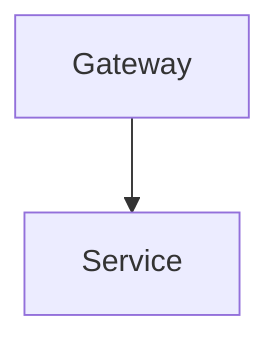

# Clean fixture

## 1. Scope (gateway)

The API gateway drops a request that carries no token. It is not a cache. The route is unchanged. The limit was measured by the load test.

The farmer opens the dashboard and the app reads the booking list. The API returns 20 rows for each page.

| Service | Responsibility |
|---|---|
| Gateway | Owns the booking row |
| Cache | Serves the UI strings |

The guard is `JwtAuthGuard` in `src/auth/guard.ts`. The p99 is under 50 ms.

The enum value `currently_robust` stays in the contract.



```text
at handler (src/auth/guard.ts:42) currently robust — delve; §
```

See [Eligibility rules](#42-eligibility-rules).
