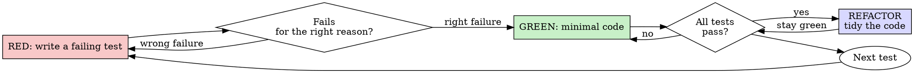

# Test-first development (TDD)

A test you have never watched fail gives you no assurance that it checks the right thing. So the loop runs in a fixed order: write the test, watch it fail, then write the least code that passes.

A claim that you kept to the intent never excuses a skipped step. Skipping any step breaks the rule, whatever purpose you served.

## The first rule

```
No production code exists until a failing test asks for it.
```

If code exists before its test:

1. Delete it, and keep no copy to refer back to.
2. Write the failing test without opening or adapting the deleted code.
3. Implement fresh, guided only by the tests.

None of these steps has an exception.

## When to use it

Use this skill for new features, bug fixes, refactoring, and behavior changes. Start before you write any implementation code.

Ask your human partner first about throwaway prototypes, generated code, and configuration files. Those three may skip the cycle, but only with agreement.

The thought "I will skip it this once" is a rationalization. Stop when you notice it.

## The cycle



### RED: one failing test

Write one minimal test for the behavior you intend to build. It needs three properties:
- It covers one behavior.
- Its name says what happens.
- It runs real code. A mock appears only when you cannot avoid it.

The good test below calls `grossPrice` and compares its result with a figure computed by hand. Before the feature exists, `grossPrice` is a stub that returns a wrong number. The assertion therefore fails.

```typescript
test('adds 20 percent VAT to a net price', () => {
  expect(grossPrice(100)).toBe(120);
});
```

The bad test has a vague name. It builds a mock in place of the price function, calls it once, and counts the calls. `grossPrice` never runs.

```typescript
test('price works', () => {
  const price = jest.fn().mockReturnValue(120);
  price(100);
  expect(price).toHaveBeenCalledTimes(1);
});
```

The rules in [core.md](core.md) govern every red step.

### Verify RED (mandatory)

You always run this step. Run the new test.

```bash
npm test src/example/example.test.ts
```

Check three things:
- The run reports a failure, not an error.
- The failure message is the one you expected.
- A missing feature causes the failure, not a typo.

A passing test covers behavior that already exists, so fix the test. An erroring test needs its error fixed. Rerun until it fails the right way.

### GREEN: the simplest passing code

Write the least code that satisfies the test. For the VAT test, that is one line.

```typescript
export const grossPrice = (net: number): number => net * 1.2;
```

The over-built version adds options no test requested, then leaves the body empty with a YAGNI note.

```typescript
export function grossPrice(
  net: number,
  opts: { currency?: string; rounding?: 'up' | 'down'; rateTable?: Record<string, number> } = {},
): number {
  // YAGNI
}
```

Do not add features, refactor other code, or improve anything the test does not demand.

### Verify GREEN (mandatory)

You never skip this step either. It takes two runs.

Run 1 repeats the RED command on the new test:

```bash
npm test src/example/example.test.ts
```

Run 2 is the project's own test command with no file argument. That is bare `pytest`, `npm test`, `cargo test`, or the repo's equivalent. Do run 2 before you call the change done. Do it even when the task named a single test file. The task's scope sets what you deliver. Verification still covers the whole suite.

Act on what the two runs show:

| Result | Action |
|---|---|
| The new test is red | Change the code. Leave the test as written. |
| Any other test in the suite is red | Fix it now. A green new test is not a green suite. |
| The output shows an error or a warning | Clear it. Green also means clean output. |
| Everything is green and the output is clean | Move on to REFACTOR. |

Your report lists every red test from run 2 by name, including ones you did not cause. A count alone is not enough. Leaving a red test out makes the report false.

### REFACTOR: clean up

Refactor only after green. You may remove duplication, improve names, and extract helpers. Keep the tests green and add no behavior.

### Repeat

Take the next piece of behavior and write its failing test.

## Worked example: a bug fix

The bug: `addToCart` accepts a quantity of zero.

RED. The test passes a quantity of zero and expects the error `Quantity must be positive`.

```typescript
test('rejects a zero quantity', () => {
  expect(addToCart({ sku: 'A1', quantity: 0 }).error).toEqual('Quantity must be positive');
});
```

Verify RED:

```bash
npm test
# FAIL: expected 'Quantity must be positive', got undefined
```

GREEN. A guard in `addToCart` returns that error when the quantity is not above zero.

```typescript
function addToCart(line: { sku: string; quantity: number }) {
  if (!(line.quantity > 0)) {
    return { error: "Quantity must be positive" };
  }
  // ...
}
```

Verify GREEN:

```bash
npm test
# PASS
```

REFACTOR. If more fields need the same kind of check, extract the validation.

## Debugging

You found a bug? Write a failing test that reproduces it, then run the cycle. That test proves the fix, and it stops the bug from coming back.

Never fix a bug without a test.

## What a good test looks like

| Trait | Good | Bad |
|---|---|---|
| Minimal | Covers one thing. An "and" in the name means split it. | `validates email and domain and whitespace` |
| Clear | The name describes the behavior. | `test1` |
| Shows intent | Demonstrates the API you want. | Hides what the code should do. |

When you write or change any test, read [writing-good-tests.md](writing-good-tests.md). Its rules keep tests honest. Its gate checks include these four:
- Before writing the test, name the production change that would make it fail.
- Assert on real behavior, never on mock behavior.
- Keep test-only code in test utilities, out of production classes.
- Understand a dependency's side effects before you mock it.

## Completion checklist

Mark work complete only when you can tick every box.

For each test:
- [ ] You saw it fail before its code existed.
- [ ] It failed because the feature was missing, not because of a typo.
- [ ] The code you wrote for it was the least that turned it green.
- [ ] It runs real code, and any mock in it was unavoidable.

For the change as a whole:
- [ ] Each new function or method has a test.
- [ ] Edge cases and error paths have tests.
- [ ] The whole suite is green, and its output holds no error or warning.

A box you cannot tick means the cycle never ran. Start the work again from RED.

## Closing rule

```
Production code needs a test that existed first and failed first.
Without that, the work is not TDD.
```

Ask your human partner before you make an exception.

## When you are stuck

Begin at the assertion. Write the call you wish the API offered, then assert on its result. Still blocked? Ask your human partner.

Once a draft exists, read it as a design review:
- It needs a mock for every collaborator. The code is too coupled, so inject its dependencies.
- It is complicated. The design is complicated, so make the interface simpler.
- Its setup runs long. Move the setup into helpers. If it stays long, simplify the design.

## Rationalizations

Each row pairs an excuse for skipping test-first with the fact that defeats it and the step you take instead.

| Excuse | Why it fails | What you do |
|---|---|---|
| Tests after it works | The next regression can slip past a test that passed on its first run; that pass says nothing about whether it catches bugs. Edge cases you forgot stay untested. | Write the test before the code and watch it fail. |
| Order does not matter | Your reviewer gets a coverage number but no evidence any test works, and each test may test the wrong thing or the implementation. Written after, tests record today's behavior and the cases you remember; written first, they state required behavior and make you find new cases. | Write the test first, so it states the behavior you need. |
| Old code as a reference | Your tests end up shaped by the code you adapt from it, which turns the work back into testing after. | Delete the code. Keep no copy open. |
| Too simple to test | Your next edit to simple code has no guard, and simple code breaks too. Its test takes about 30 seconds. | Write the test. |
| Already checked by hand | After your next change nothing re-runs that check, because it left no record and covered only what you tried. Under pressure you forget cases; an automated test runs identically every time. | Turn the check into an automated test. |
| Manual checking is faster | Every later change means redoing the check by hand, and the check never proves an edge case. | Automate the check once and rerun it after each change. |
| Deleting hours of work | Code you cannot trust costs you on every later change. The hours are spent on either path, which makes them a sunk cost. | Redo it with TDD and trust the result. Keeping it means adding tests later and expecting bugs. |
| TDD slows me down | Debugging in production costs more than any shortcut saves. TDD is faster overall: it catches bugs before commit, blocks regressions, and keeps refactoring safe. | Run the cycle. |
| Exploring first | Nothing forbids exploring, as long as the exploration does not become the code you keep. | Explore, throw the exploration away, then start with TDD. |
| Hard to test | Your callers will find hard-to-test code hard to use as well. The difficulty is feedback on the design. | Treat it as design feedback and change the design. |
| No tests existed before | You are changing that code now, and your change lands on code nothing protects. | Add tests for the existing code you are improving. |

Whatever the excuse, only the test-first order gives you a failure you observed.

## Red flags: stop and start over

When any of these is true, delete the code and restart with TDD.

The order of events shows it:
- Code was written before its test.
- A test was written after the implementation.
- A new test was green on its first run.
- You cannot say why a test failed.

You catch yourself thinking it:
- "I'll add the tests later."
- "Just this once."
- "I already tested it manually."
- "Testing afterwards gets the same result."
- "The spirit counts, not the ritual."
- "I'll keep it to look at" or "I'll adapt what is there."
- "I sank X hours into this, and deleting wastes them."
- "TDD is dogma. I'm being practical."
- "This one is a special case, so the rule bends."
